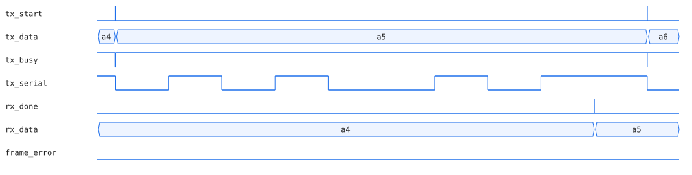

# UART 송수신기 (Verilog)

100 MHz 클럭 기준 115200 baud 8N1 UART 송신기와 수신기를 RTL로 설계하고 Icarus Verilog testbench로 검증했습니다.



*0xA5를 송신하는 한 프레임. LSB부터 1 0 1 0 0 1 0 1이 start bit(0)와 stop bit(1) 사이에 실리고 프레임이 끝나기 직전 수신기가 `rx_done`과 함께 0xA5를 내놓습니다. testbench VCD를 SVG로 그린 그림입니다.*

## 설계

| 모듈 | 구조 |
|---|---|
| `rtl/uart_tx.v` | IDLE → START → DATA → STOP 상태 머신. 비트당 `CLK_FREQ / BAUD_RATE` 클럭(868)을 세며 LSB부터 내보냄 |
| `rtl/uart_rx.v` | 입력을 2단 플립플롭으로 동기화한 뒤 start bit 하강 에지를 잡고 비트 중앙에서 샘플링. stop bit가 0이면 `frame_error`를 올림 |

`CLK_FREQ`와 `BAUD_RATE`는 parameter라 다른 클럭과 속도에 그대로 쓸 수 있습니다.

## 검증 항목

| 테스트 | 내용 | 결과 |
|---|---|---|
| 전수 루프백 | 송신기 출력을 수신기에 물려 0x00~0xFF 256개 값을 모두 보내고 받은 값 비교 | 오류 0 |
| 연속 프레임 | 프레임 사이 쉬는 시간 없이 이어 보내도 경계를 놓치지 않는지 확인 | 오류 0 |
| 정상 프레임 | 수신기에 직접 0x7E 프레임을 넣고 `frame_error = 0` 확인 | PASS |
| stop bit 깨짐 | stop bit를 0으로 넣었을 때 `frame_error`가 올라오는지 확인 | PASS |

```
Exhaustive 256-byte loopback: 0 errors so far
Back-to-back framing: 0 errors so far
PASS [good frame]: data=0x7e frame_error=0
PASS [bad stop bit]: frame_error correctly asserted
ALL TESTS PASSED
```

## 만들면서 겪은 문제

처음 작성한 testbench는 수신 완료를 기다리는 부분에서 시뮬레이션이 끝나지 않고 멈췄습니다. 원인은 RTL이 아니라 testbench가 신호 타이밍을 잘못 가정한 race condition이었고 기다리는 조건을 고쳐 해결했습니다. 테스트가 안 끝나는 이유가 설계가 아니라 검증 코드에 있을 수 있다는 걸 이때 처음 겪었습니다.

## 실행

```bash
mkdir -p sim && cd sim
iverilog -g2012 -o uart_sim ../rtl/uart_tx.v ../rtl/uart_rx.v ../tb/uart_tb.v
vvp uart_sim          # uart_tb.vcd 생성. GTKWave로 열어볼 수 있음
```

## 범위

시뮬레이션 검증까지 진행했습니다. FPGA 보드에 합성해서 실물로 돌려본 적은 아직 없습니다.

관련 저장소: [axi_lite_slave](https://github.com/yjh6948/axi_lite_slave) · [verif-agent](https://github.com/yjh6948/verif-agent)
